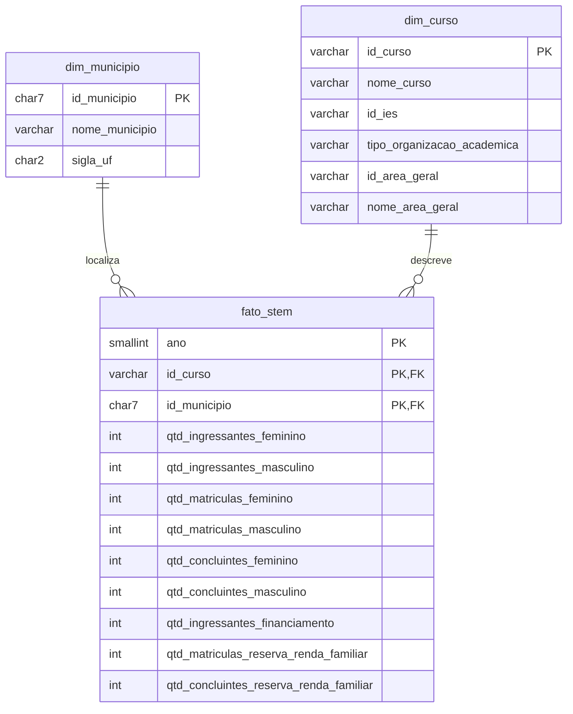

# Observatório STEM — Projeto Final de Big Data

Pipeline completo de dados e camada de Analytics do Observatório de cursos de graduação STEM no Brasil.

**Equipe:** Helena Musse de Souza, Luiza Gabriella dos Santos, Maria Eduarda Candeias Miranda,
Tharsyla Jones Luz de Andrade.

```
Base dos Dados (BigQuery)  →  ETL em Python/Pandas  →  PostgreSQL (Aiven)
        origem                  tratamento + modelagem        destino
                         infraestrutura provisionada com Terraform
                 ├── Streamlit: análise interativa
                 └── Grafana: observabilidade do banco
```

---

## Estrutura do repositório

```
.
├── etl/
│   ├── etl_stem.py          # extração, tratamento, modelagem e carga
│   └── requirements.txt     # dependências Python
├── sql/
│   ├── 01_ddl.sql           # tabelas (PK, FK, índices)
│   └── 02_validacoes.sql    # consultas de conferência
├── infra/terraform/         # infraestrutura como código
│   ├── versions.tf          # provider do Aiven
│   ├── variables.tf
│   ├── main.tf              # PostgreSQL no Aiven
│   ├── outputs.tf
│   ├── terraform.tfvars.example
│   └── gcp/                 # opcional: API do BigQuery e conta de serviço
├── dashboard/                 # painel analítico Streamlit
│   ├── app.py
│   ├── requirements.txt
│   └── .streamlit/config.toml
├── grafana/                   # dashboard operacional Grafana
│   ├── dashboards/observatorio-stem.json
│   └── README.md
├── data/
│   └── base_tratada.zip     # base tratada (3 CSVs)
├── docs/
│   └── decisoes_tecnicas.md
├── .env.example             # variáveis de ambiente
└── .gitignore
```

---

## 1. Dados utilizados

- **Fonte:** [Base dos Dados](https://basedosdados.org), via Google BigQuery
- **Base:** Censo da Educação Superior (INEP), tabela `br_inep_censo_educacao_superior.curso`
- **Apoio:** diretório de municípios (nome e UF) e dicionário de códigos
- **Recorte:** áreas STEM da CINE Brasil: 05 (ciências naturais e matemática), 06 (computação) e 07 (engenharias)
- **Período:** 2015 a 2024
- **Indicadores:** ingressantes, matrículas e concluintes por sexo, financiamento estudantil e reserva de vagas por renda

**Características da base**

- **Cursos EAD aparecem uma vez por polo.** Um curso de 2022 tinha 441 linhas, uma por município. Por isso a extração trouxe 660.043 linhas para cerca de 99 mil cursos/ano.
- **Municípios inválidos:** 11.214 linhas com código `0` ou sem correspondência no diretório.
- **Formatos inconsistentes:** área como `5` ou `05`, nomes com espaços e maiúsculas variados.
- **Nulos significam "não informado",** não zero.

## 2. Tratamento realizado

O tratamento segue quatro etapas, todas em `etl/etl_stem.py`.

### Etapa 1 - Filtrar na origem

A consulta ao BigQuery já traz só os cursos STEM de 2015 a 2024, em vez da base inteira. Assim o volume cabe no plano gratuito do banco.

### Etapa 2 - Limpar e padronizar

- O código da área fica sempre com 2 dígitos (`5` vira `05`).
- Os nomes ficam em maiúsculas e sem espaços sobrando.
- Quantidades vazias continuam vazias (nulas). Vazio quer dizer "não informado", e não zero.
- As 11.214 linhas com município inválido (código `0` ou fora do diretório do IBGE) vão para um município "NAO INFORMADO". Assim o curso continua entrando nos totais.

### Etapa 3 - Resolver as repetições

Na primeira carga, a extração trouxe 660 mil linhas, mas só existiam cerca de 99 mil combinações de curso e ano.

- O dicionário de códigos tinha mais de uma linha para o mesmo código, e isso repetia cursos na junção. Agrupamos o dicionário antes de juntar.
- Os cursos EAD aparecem uma vez para cada polo. Um curso de 2022, por exemplo, tinha 441 linhas, uma por município, cada uma com parte dos alunos.

Por isso mantivemos todas as linhas, e cada registro passou a ser um curso, em um município, em um ano. Sobraram 392 linhas repetidas nessa combinação, e somamos as quantidades delas.

### Etapa 4 - Organizar e carregar

Os dados são separados em três tabelas (municípios, cursos e indicadores, ver [Modelagem](#3-modelagem)) e carregados no PostgreSQL de uma vez só. Se der erro no meio da carga, nada é gravado e o banco fica como estava.

## 3. Modelagem

Usamos um esquema estrela: uma tabela central com os números e duas tabelas em volta com as descrições. Esse formato facilita somar os dados por ano, estado e área, que é o tipo de análise que vamos fazer nas próximas fases. O diagrama abaixo foi feito em Mermaid.



- `dim_municipio`: nome e estado dos municípios onde os cursos são oferecidos.
- `dim_curso`: nome, instituição e área de cada curso.
- `fato_stem`: os números (ingressantes, matrículas, concluintes etc.) de cada curso, em cada município, em cada ano. Para ter o total de um curso no ano, é só somar os municípios.

As tabelas são criadas pelo arquivo `sql/01_ddl.sql`, que define os tipos das colunas, as chaves e os índices. Preferimos isso a deixar o Pandas criar as tabelas sozinho.

## 4. Infraestrutura

O projeto usa três serviços:

- **Google BigQuery:** onde a Base dos Dados publica o Censo. O ETL só faz consultas lá.
- **Google Colab:** onde o ETL em Python roda. Ele se conecta ao BigQuery com a conta Google de quem está executando.
- **Aiven PostgreSQL:** o banco onde ficam as tabelas tratadas, no plano gratuito.

### Terraform

O banco é gerenciado pelo Terraform, na pasta infra/terraform/. O recurso aiven_pg.obs_stem representa o PostgreSQL no Aiven (projeto bigdata-hm, serviço pg-3c0071ef, plano free-1-1gb), com proteção contra exclusão. No final, o Terraform mostra o host, a porta, o usuário e a senha do banco (a senha fica marcada como sensível).

A pasta infra/terraform/gcp/ é opcional. Ela ativa a API do BigQuery e cria uma conta de serviço que só pode fazer consultas, para usar se um dia o ETL rodar de forma automática. Deixamos separada para o banco poder ser criado só com o token do Aiven.

Tecnologias
Infraestrutura: Terraform 1.5+ com o provider do Aiven (e o do Google, na pasta opcional gcp/)
Código: Python 3.10+, Pandas no tratamento e SQLAlchemy/psycopg2 para falar com o banco
Dados: biblioteca google-cloud-bigquery para as consultas
## 5. Segurança das informações

Nenhuma senha ou token fica no repositório. O que fizemos:

1. **Senhas fora do código.** O ETL e o dashboard leem os dados do banco de um arquivo `.env` (que o `.gitignore` impede de ir para o GitHub) ou dos Secrets do Colab e do Streamlit. No repositório fica só o `.env.example`, que tem os nomes das variáveis, sem os valores.
2. **Login no Google sem arquivo de chave.** No Colab, o acesso ao BigQuery é feito com a conta Google de quem executa.
3. **Terraform.** O token do Aiven é passado pela variável de ambiente `AIVEN_TOKEN`. Os arquivos `terraform.tfvars` e `*.tfstate`, que guardam a senha do banco, estão no `.gitignore`.
4. **Conexão criptografada.** A conexão com o banco usa SSL (`sslmode=require`).
5. **Proteção contra exclusão** ligada no banco (`termination_protection`).

Uma versão antiga do script tinha a senha do banco escrita no código. Trocamos a senha, tiramos ela do código e apagamos o histórico do Git onde ela aparecia.

## 6. Execução

### Pré-requisitos

- Conta no Aiven (plano gratuito) e um token de API
- Projeto no Google Cloud com a API do BigQuery ativada (o modo gratuito Sandbox serve)
- Terraform 1.5+ e, para rodar o ETL no computador, Python 3.10+

### Passo 1 — Infraestrutura

```bash
cd infra/terraform
cp terraform.tfvars.example terraform.tfvars   # nome do projeto e do serviço no Aiven
export AIVEN_TOKEN="..."                       # PowerShell: $env:AIVEN_TOKEN="..."

terraform init
terraform import aiven_pg.obs_stem <projeto>/<serviço>   # só se o serviço já existir
terraform plan
terraform apply

terraform output                       # host, porta e usuário
terraform output -raw pg_password      # senha (vai para os Secrets)
```

### Passo 2 — Configuração

Para rodar no computador, copie o modelo e preencha com os dados do banco:

```bash
cp .env.example .env
pip install -r etl/requirements.txt
```

No Colab, cadastre as mesmas variáveis do `.env.example` no painel Secrets (ícone de chave) e rode:

```python
!git clone https://github.com/BIG-D26/Projeto_Final_BIGD.git
%cd Projeto_Final_BIGD
!pip install -q -r etl/requirements.txt
%run etl/etl_stem.py
```

### Passo 3 — ETL

```bash
python etl/etl_stem.py
```

O script faz, nesta ordem:

1. Lê as configurações (`.env` ou Secrets do Colab)
2. Busca no BigQuery os cursos STEM a partir de `ANO_INICIO`
3. Limpa e padroniza os dados
4. Separa em `dim_municipio`, `dim_curso` e `fato_stem`
5. Salva a base tratada em CSV (`data/processed/`). A versão final está em `data/base_tratada.zip`
6. Cria as tabelas com `sql/01_ddl.sql` e carrega tudo de uma vez
7. Conta as linhas no banco para conferir a carga

### Passo 4 — Validação

As consultas de conferência estão em `sql/02_validacoes.sql` e podem ser rodadas em qualquer cliente PostgreSQL (DBeaver, psql etc.).

### Resultado da carga

- `dim_municipio`: 3.278 linhas · `dim_curso`: 14.344 linhas · `fato_stem`: 659.651 linhas
- Período: 2015 a 2024 · tamanho do banco: 131 MB
- 660.043 linhas extraídas − 392 somadas = 659.651 linhas na fato
- 10.822 linhas da fato com município "NAO INFORMADO"
- Participação feminina nas matrículas STEM: 31,1% em 2015 e 27,2% em 2024

## 7. Dashboard analítico — Streamlit

O dashboard em Streamlit é onde os dados são explorados. Ele lê o PostgreSQL e tem filtros por período, estado, área STEM, sexo e métrica. Mostra quatro indicadores no topo, a evolução por ano, a divisão por sexo, a distribuição por área e por estado, uma tabela detalhada e um botão para baixar os dados em CSV.

### Executar localmente

Instale as dependências e preencha o `.env` na raiz do projeto com as variáveis `PG_*`:

```bash
pip install -r dashboard/requirements.txt
streamlit run dashboard/app.py
```

### Publicar no Streamlit Community Cloud

1. Em share.streamlit.io, crie um app apontando para `dashboard/app.py` deste repositório.
2. Em **Settings → Secrets**, cadastre `PG_HOST`, `PG_PORT`, `PG_DATABASE`, `PG_USER` e `PG_PASSWORD`.
3. Como o repositório está numa organização do GitHub, o acesso do Streamlit precisa ser liberado pela organização antes do primeiro deploy.

## 8. Monitoramento — Grafana

O Grafana complementa o Streamlit. Ele acompanha a saúde do banco: quantidade de registros e de cursos, último ano carregado, tamanho do banco e matrículas por sexo e ano. A análise dos dados em si fica no Streamlit.

Para configurar, siga o `grafana/README.md` e importe o `grafana/dashboards/observatorio-stem.json` no Grafana Cloud. O PostgreSQL entra como fonte de dados, com SSL obrigatório. As credenciais ficam na configuração do Grafana, nunca no JSON do repositório.

## 9. Escopo analítico e limitações dos dados

A tabela `curso` traz os números somados por curso, município, ano e sexo. Ela não tem raça/cor nem acompanha os mesmos alunos ao longo dos anos. Isso significa que:

- Dá para analisar participação e distribuição por sexo, área, estado e período.
- Não dá para cruzar gênero com raça/cor (ODS 18) com os dados atuais. O recorte atual ajuda na discussão sobre igualdade de gênero (ODS 5).
- Dividir concluintes por ingressantes no mesmo ano não é taxa de evasão, porque são grupos de pessoas diferentes.
- Para calcular evasão ou retenção de verdade, seria preciso usar dados que acompanhem cada turma ao longo dos anos.
- Os indicadores são descritivos: mostram o que acontece, mas não explicam as causas.
