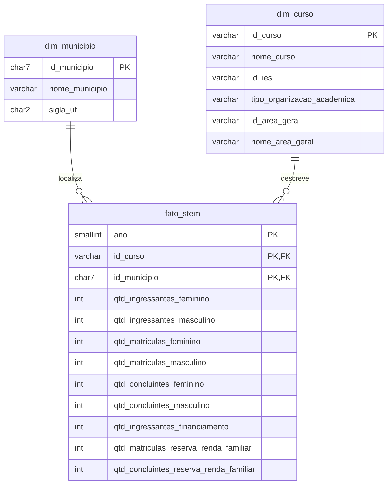

# Observatório STEM — Projeto Final de Big Data

Camada de dados do projeto: extração, tratamento, modelagem e armazenamento em nuvem
de indicadores dos cursos de graduação STEM no Brasil (Marco 2).

**Equipe:** Helena Musse de Souza, Luiza Gabriella dos Santos, Maria Eduarda Candeias Miranda,
Tharsyla Jones Luz de Andrade.

```
Base dos Dados (BigQuery)  →  ETL em Python/Pandas  →  PostgreSQL (Aiven)
        origem                  tratamento + modelagem        destino
                         infraestrutura provisionada com Terraform
```

---

## Estrutura do repositório

```
.
├── etl/
│   ├── etl_stem.py          # extração, tratamento, modelagem e carga
│   └── requirements.txt     # dependencias Python
├── sql/
│   ├── 01_ddl.sql           # tabelas (PK, FK, idndices)
│   └── 02_validacoes.sql   
├── infra/terraform/         # infraestrutura como código
│   ├── versions.tf          # providers (Aiven e Google)
│   ├── variables.tf
│   ├── main.tf              # PostgreSQL no Aiven + BigQuery
│   ├── outputs.tf
│   └── terraform.tfvars.example
├── docs/
│   └── decisoes_tecnicas.md
├── .env.example             # variáveis de ambiente
└── .gitignore
```

---

## 1. Dados utilizados

- **Fonte:** [Base dos Dados](https://basedosdados.org), via Google BigQuery
- **Base:** Censo da Educação Superior (INEP), tabela `br_inep_censo_educacao_superior.curso`
- **Apoio:** diretório de municípios (nome e UF) e dicionário de códigos
- **Recorte:** áreas STEM da CINE Brasil: 05 (ciências naturais e matemática), 06 (computação) e 07 (engenharias)
- **Período:** 2015 a 2024
- **Indicadores:** ingressantes, matrículas e concluintes por sexo, financiamento estudantil e reserva de vagas por renda

**Características da base**

- **Cursos EAD aparecem uma vez por polo.** Um curso de 2022 tinha 441 linhas, uma por município. Por isso a extração trouxe 660.043 linhas para cerca de 99 mil cursos/ano.
- **Municípios inválidos:** 11.214 linhas com código `0` ou sem correspondência no diretório.
- **Formatos inconsistentes:** área como `5` ou `05`, nomes com espaços e maiúsculas variados.
- **Nulos significam "não informado",** não zero.

## 2. Tratamento realizado

O tratamento segue quatro etapas, todas em `etl/etl_stem.py`.

### 1️ -Filtrar na origem
Em vez de baixar a base inteira, a consulta ao BigQuery já traz **só os cursos STEM de 2015 a 2024**.
Assim o volume cabe no plano gratuito do banco.

### 2️ - Limpar e padronizar
- Área sempre com 2 dígitos (`5` → `05`)
- Nomes sem espaços extras e em maiúsculas
- Quantidades vazias mantidas como nulas, porque "não informado" não é zero
- Municípios inválidos (**11.214 linhas**, código `0`) vão para um registro **"NAO INFORMADO"**, para o curso continuar contando nos totais

### 3️ - Resolver as repetições
Ao conferir a primeira carga, vimos **660 mil linhas extraídas para só 99 mil cursos/ano**. Investigamos e encontramos duas causas:

- **O dicionário de códigos tinha linhas repetidas**, e isso duplicava cursos na junção. Corrigimos agrupando o dicionário antes.
- **Cursos EAD aparecem uma vez por polo.** Um curso de 2022 tinha 441 linhas, uma por município, cada uma com parte dos alunos.

Por isso **mantivemos todas as linhas**: cada registro passou a ser **curso × município × ano**.
As 392 linhas que ainda repetiam a mesma combinação tiveram as quantidades somadas.

### 4️ - Organizar e carregar
Os dados são separados em municípios, cursos e indicadores (ver [Modelagem](#3-modelagem)) e carregados no PostgreSQL de uma vez só.
Se der erro no meio, nada é gravado e o banco continua como estava.
## 3. Modelagem

Foi adotado um **esquema estrela** (modelo dimensional), adequado para consultas analíticas
de agregação por tempo, local e área, que é o uso previsto nas próximas fases. (feito com mermaid)



- **dim_municipio**: dados geográficos dos municípios onde os cursos são ofertados.
- **dim_curso**: identificação e classificação dos cursos STEM.
- **fato_stem**: indicadores quantitativos, um registro por curso, município e ano. Somando os municípios, obtém-se o total do curso no ano.
- O DDL (`sql/01_ddl.sql`) define tipos, chaves primárias, chaves estrangeiras e índices,
  em vez de deixar o Pandas criar as tabelas automaticamente.

## 4. Infraestrutura

O projeto usa três serviços em nuvem, cada um com um papel:

** Google BigQuery: de onde vêm os dados**
É onde a Base dos Dados publica o Censo. O ETL só faz consultas, nada é gravado lá.

**Google Colab: onde o código roda**
O ETL em Python é executado no Colab, que já tem o ambiente pronto e se conecta ao BigQuery com a conta Google de quem executa.

**Aiven PostgreSQL: onde os dados ficam**
O banco de destino, no plano gratuito do Aiven. É aqui que ficam as tabelas tratadas.

### Terraform

A pasta `infra/terraform/` descreve essa infraestrutura como código:

- **`aiven_pg.obs_stem`**: o banco PostgreSQL no Aiven (projeto `obssteam`, serviço `obsstem`), com proteção contra exclusão acidental
- **`google_project_service.bigquery`**: ativa a API do BigQuery no projeto Google
- **`google_service_account.etl`**: uma conta de serviço só com permissão de consulta, preparada para execuções automáticas no futuro

O banco foi criado primeiro pelo painel do Aiven. Os arquivos foram escritos para representar esse mesmo banco e passaram no `terraform validate`. Falta apenas importar o banco existente para o Terraform (`terraform import`), o que depende do token da conta Aiven.

### Tecnologias

- **Infraestrutura:** Terraform 1.5+, com os providers do Aiven e do Google
- **Código:** Python 3.10+, com Pandas para o tratamento e SQLAlchemy/psycopg2 para o banco
- **Dados:** biblioteca `google-cloud-bigquery` para as consultas

## 5. Segurança das informações

Nenhuma credencial é versionada. A estratégia adotada foi:

1. **Variáveis de ambiente**: o ETL lê host, porta, usuário e senha do banco de um arquivo `.env`
   local (ignorado pelo Git) ou, no Colab, do painel **Secrets**. O repositório contém apenas o
   modelo `.env.example`, sem valores reais.
2. **Sem chave JSON no Colab**: a autenticação no Google é feita com `auth.authenticate_user()`
   (conta do próprio usuário). Localmente, usa-se `gcloud auth application-default login`.
3. **Terraform**: o token do Aiven é lido da variável de ambiente `AIVEN_TOKEN`. Os arquivos
   `terraform.tfvars` e `*.tfstate` (que contêm a senha do banco) estão no `.gitignore`.
   A senha é exposta apenas como *output* `sensitive`. A chave da service account não é gerada
   pelo Terraform para não ficar gravada no state.
4. **Conexão criptografada**: o ETL conecta ao PostgreSQL com `sslmode=require`.
5. **Privilégio mínimo**: a service account do ETL só pode executar consultas.
6. **`termination_protection`** ativo no banco, contra exclusão acidental.

## 6. Execução

### Pré-requisitos

- Conta no Aiven (com token de API) e projeto no Google Cloud com a API do BigQuery ativada (o modo gratuito Sandbox é suficiente)
- Terraform ≥ 1.5, Python ≥ 3.10 e Google Cloud CLI (para execução local)

### Passo 1 — Infraestrutura

```bash
cd infra/terraform
cp terraform.tfvars.example terraform.tfvars   
export AIVEN_TOKEN="..."                         
gcloud auth application-default login

terraform init

terraform import aiven_pg.obs_stem obssteam/obsstem
terraform plan
terraform apply

terraform output                       # host, porta e usuário
terraform output -raw pg_password      # senha (secrets)
```

### Passo 2 — Configuração

```bash
cp .env.example .env    
pip install -r etl/requirements.txt
```

No **Google Colab**, cadastre as chaves do `.env.example` no painel **Secrets** e execute:

```python
!git clone https://github.com/luiza-00/Projeto_Final_BIGD.git
%cd Projeto_Final_BIGD
!pip install -q -r etl/requirements.txt
%run etl/etl_stem.py
```

### Passo 3 — ETL

```bash
python etl/etl_stem.py
```

Sequência executada pelo script:

1. Lê as configurações (`.env` ou Secrets do Colab)
2. **Extrai** do BigQuery os cursos STEM a partir de `ANO_INICIO`
3. **Trata** os dados (tipos, padronização, nulos)
4. **Modela** em `dim_municipio`, `dim_curso` e `fato_stem`
5. Salva a base tratada em CSV (`data/processed/`)
6. Executa `sql/01_ddl.sql` e **carrega** as tabelas em uma única transação
7. **Valida** a carga (contagem de linhas e tamanho do banco)

### Passo 4 — Validação

Execute as consultas de `sql/02_validacoes.sql` em qualquer cliente PostgreSQL (DBeaver, psql etc.).
