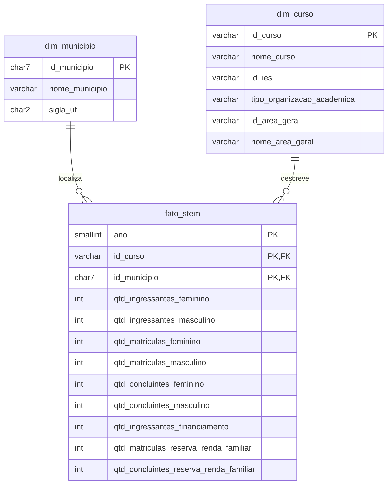

# Observatório STEM — Projeto Final de Big Data

Camada de dados do projeto: extração, tratamento, modelagem e armazenamento em nuvem
de indicadores dos cursos de graduação STEM no Brasil (Marco 2).

**Equipe:** Helena Musse de Souza, Luiza Gabriella dos Santos, Maria Eduarda Candeias Miranda,
Tharsyla Jones Luz de Andrade.

```
Base dos Dados (BigQuery)  →  ETL em Python/Pandas  →  PostgreSQL (Aiven)
        origem                  tratamento + modelagem        destino
                         infraestrutura provisionada com Terraform
```

---

## Estrutura do repositório

```
.
├── etl/
│   ├── etl_stem.py          # extração, tratamento, modelagem e carga
│   └── requirements.txt     # dependencias Python
├── sql/
│   ├── 01_ddl.sql           # tabelas (PK, FK, idndices)
│   └── 02_validacoes.sql   
├── infra/terraform/         # infraestrutura como código
│   ├── versions.tf          # providers (Aiven e Google)
│   ├── variables.tf
│   ├── main.tf              # PostgreSQL no Aiven + BigQuery
│   ├── outputs.tf
│   └── terraform.tfvars.example
├── docs/
│   └── decisoes_tecnicas.md
├── .env.example             # variáveis de ambiente
└── .gitignore
```

---

## 1. Dados utilizados

- **Fonte:** [Base dos Dados](https://basedosdados.org), via Google BigQuery
- **Base:** Censo da Educação Superior (INEP), tabela `br_inep_censo_educacao_superior.curso`
- **Apoio:** diretório de municípios (nome e UF) e dicionário de códigos
- **Recorte:** áreas STEM da CINE Brasil: 05 (ciências naturais e matemática), 06 (computação) e 07 (engenharias)
- **Período:** 2015 a 2024
- **Indicadores:** ingressantes, matrículas e concluintes por sexo, financiamento estudantil e reserva de vagas por renda

**Características da base**

- **Cursos EAD aparecem uma vez por polo.** Um curso de 2022 tinha 441 linhas, uma por município. Por isso a extração trouxe 660.043 linhas para cerca de 99 mil cursos/ano.
- **Municípios inválidos:** 11.214 linhas com código `0` ou sem correspondência no diretório.
- **Formatos inconsistentes:** área como `5` ou `05`, nomes com espaços e maiúsculas variados.
- **Nulos significam "não informado",** não zero.

## 2. Tratamento realizado

| Problema / característica | Decisão | Justificativa |
|---|---|---|
| Volume grande da base completa | Filtrar áreas STEM e anos na própria consulta ao BigQuery | Reduz o tráfego e cabe no limite do plano gratuito do Aiven |
| Série histórica com vários anos | Incluir a coluna `ano` na fato | Sem o ano, os indicadores de anos diferentes se misturam |
| Cursos EAD com uma linha por município de polo | Grão da fato definido como **curso × município × ano** | Cada linha é uma parte dos alunos do curso; manter todas preserva o total e a distribuição geográfica |
| Códigos de área inconsistentes | Padronizar com 2 dígitos (`zfill`) | Garante filtro e agrupamento corretos |
| Códigos sem descrição | Join com o dicionário (`tipo_organizacao_academica`) | Torna o dado legível para análise |
| Nomes com variação de grafia | `strip` + maiúsculas; na dimensão fica a versão **mais recente** | Evita duplicar o mesmo curso ou município na dimensão |
| Quantidades nulas | Mantidas como `NULL` (inteiro anulável) | Diferencia "não informado" de "zero" |
| Dicionário com mais de uma linha por código (uma por período) multiplicava os cursos na junção | Dicionário agrupado por código antes da junção (`GROUP BY chave`) | Evita duplicar cursos e inflar as quantidades |
| Mais de uma linha com o mesmo curso, município e ano | Quantidades somadas | Garante a chave primária sem perder alunos |
| Curso sem `id_curso` | Registro removido | Não pode ser relacionado à dimensão |
| Município inválido (ex.: código `0`) ou sem correspondência no diretório | Atribuído ao registro `0000000` "NAO INFORMADO" (UF `NI`) da dimensão | O curso continua contabilizado e a chave estrangeira é respeitada |
| Tabela intermediária `raw_censo_stem` | Removida | Duplicava os dados e ocupava espaço do plano gratuito |

As transformações estão em `etl/etl_stem.py` (funções `tratar` e `modelar`).

## 3. Modelagem

Foi adotado um **esquema estrela** (modelo dimensional), adequado para consultas analíticas
de agregação por tempo, local e área, que é o uso previsto nas próximas fases.



- **dim_municipio**: dados geográficos dos municípios onde os cursos são ofertados.
- **dim_curso**: identificação e classificação dos cursos STEM.
- **fato_stem**: indicadores quantitativos, um registro por curso, município e ano. Somando os municípios, obtém-se o total do curso no ano.
- O DDL (`sql/01_ddl.sql`) define tipos, chaves primárias, chaves estrangeiras e índices,
  em vez de deixar o Pandas criar as tabelas automaticamente.

## 4. Infraestrutura

| Serviço | Uso | Recurso no Terraform |
|---|---|---|
| **Aiven for PostgreSQL** (free tier) | Banco de dados de destino | `aiven_pg.obs_stem` |
| **Google Cloud / BigQuery** | Execução das consultas na Base dos Dados | `google_project_service.bigquery` |
| **Service Account GCP** | Identidade do ETL com permissão mínima (`roles/bigquery.jobUser`) | `google_service_account.etl` e `google_project_iam_member.etl_job_user` |
| **Google Colab / Python 3** | Execução do ETL | — |

Tecnologias: Terraform ≥ 1.5, providers `aiven/aiven` 4.x e `hashicorp/google` 5.x,
Python 3.10+, Pandas, SQLAlchemy, psycopg2 e google-cloud-bigquery.

## 5. Segurança das informações

Nenhuma credencial é versionada. A estratégia adotada:

1. **Variáveis de ambiente**: o ETL lê host, porta, usuário e senha do banco de um arquivo `.env`
   local (ignorado pelo Git) ou, no Colab, do painel **Secrets**. O repositório contém apenas o
   modelo `.env.example`, sem valores reais.
2. **Sem chave JSON no Colab**: a autenticação no Google é feita com `auth.authenticate_user()`
   (conta do próprio usuário). Localmente, usa-se `gcloud auth application-default login`.
3. **Terraform**: o token do Aiven é lido da variável de ambiente `AIVEN_TOKEN`. Os arquivos
   `terraform.tfvars` e `*.tfstate` (que contêm a senha do banco) estão no `.gitignore`.
   A senha é exposta apenas como *output* `sensitive`. A chave da service account não é gerada
   pelo Terraform para não ficar gravada no state.
4. **Conexão criptografada**: o ETL conecta ao PostgreSQL com `sslmode=require`.
5. **Privilégio mínimo**: a service account do ETL só pode executar consultas.
6. **`termination_protection`** ativo no banco, contra exclusão acidental.

> **Incidente corrigido:** uma versão anterior do script continha a senha do banco em texto puro.
> A senha foi trocada no Aiven, o arquivo foi removido e o histórico do repositório foi reescrito.

## 6. Execução

### Pré-requisitos

- Conta no Aiven (com token de API) e projeto no Google Cloud com a API do BigQuery ativada (o modo gratuito Sandbox é suficiente)
- Terraform ≥ 1.5, Python ≥ 3.10 e Google Cloud CLI (para execução local)

### Passo 1 — Infraestrutura

```bash
cd infra/terraform
cp terraform.tfvars.example terraform.tfvars   # preencher
export AIVEN_TOKEN="..."                         # token do Aiven
gcloud auth application-default login

terraform init
# Se o banco já existe (criado antes pelo console), importá-lo em vez de recriar:
terraform import aiven_pg.obs_stem obssteam/obsstem
terraform plan
terraform apply

terraform output                       # host, porta e usuário
terraform output -raw pg_password      # senha (não compartilhar)
```

### Passo 2 — Configuração

```bash
cp .env.example .env    # preencher com os outputs do Terraform
pip install -r etl/requirements.txt
```

No **Google Colab**, cadastre as chaves do `.env.example` no painel **Secrets** e execute:

```python
!git clone https://github.com/luiza-00/Projeto_Final_BIGD.git
%cd Projeto_Final_BIGD
!pip install -q -r etl/requirements.txt
%run etl/etl_stem.py
```

### Passo 3 — ETL

```bash
python etl/etl_stem.py
```

Sequência executada pelo script:

1. Lê as configurações (`.env` ou Secrets do Colab)
2. **Extrai** do BigQuery os cursos STEM a partir de `ANO_INICIO`
3. **Trata** os dados (tipos, padronização, nulos)
4. **Modela** em `dim_municipio`, `dim_curso` e `fato_stem`
5. Salva a base tratada em CSV (`data/processed/`)
6. Executa `sql/01_ddl.sql` e **carrega** as tabelas em uma única transação
7. **Valida** a carga (contagem de linhas e tamanho do banco)

### Passo 4 — Validação

Execute as consultas de `sql/02_validacoes.sql` em qualquer cliente PostgreSQL (DBeaver, psql etc.).
